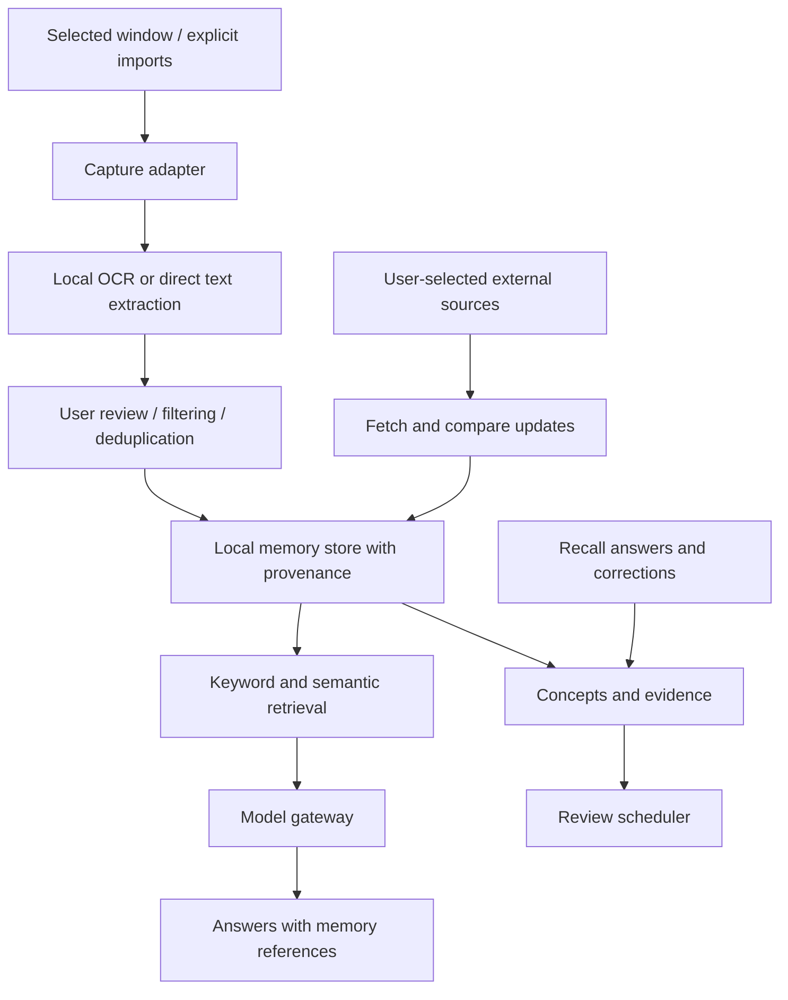
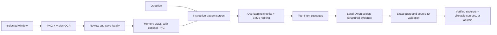

# Architecture and setup

The CV-oriented research scope, model-training experiments, agent design, and evaluation protocol are defined in [PORTFOLIO_PLAN.md](PORTFOLIO_PLAN.md). The Python research track contains an offline BM25 baseline. The native app now has its own Swift BM25-style retrieval implementation; neither uses embeddings yet.

## Product boundary

One memory across coding, college, articles, and personal interests. Separate exposure (seen), evidence (answered/applied), and tentative understanding (estimated). Passive screen activity is not proof of weakness or mastery. Casual reading should not automatically become revision homework.

## System design

Implemented now: selected-window capture with PNG preservation, local OCR, user review, manual notes, local JSON persistence, cross-memory chunk retrieval, exact-quote validation, abstention, clickable provenance, deletion, and a native app/menu bar. Learning estimation, scheduling, semantic retrieval, monitoring and agents remain planned.

## Layers and technology choices

1. **Native client:** SwiftUI for windows, status, capture scope, timeline, and chat. ScreenCaptureKit for window capture; Vision for OCR. Start on demand, later add explicit start/stop sessions with an allowlist and visible indicator.
2. **Memory engine:** Swift library in the initial app, avoiding a background server and extra installation. Move the JSON store to SQLite with transactions and full-text search before automatic sessions. Add embeddings only after keyword search has been measured. A Python worker remains optional for model experiments; it is not needed for the first milestone.
3. **Ingestion:** Prefer actual text from explicit file imports or a future browser extension over screenshots where available. Track source URL only when supplied by the source or user, never invent it from a title. Preserve document versions and extraction confidence. Deduplicate identical content and group related changes.
4. **Retrieval:** Combine keyword and semantic candidates; filter by date/source/topic; return original passages and stable IDs. Distinguish quotes, retrieved observations, and generated conclusions. No-match results should say there is insufficient memory.
5. **Model gateway:** One interface for summarization, grounded answers, concept extraction, and question generation. Current deployment uses local Ollama and Qwen 2.5 7B exclusively, matching the zero-budget requirement. No cloud provider or credentials are needed. If cloud integration is ever added, it requires a separate opt-in data boundary.
6. **Learning model:** Concepts link to observations and evidence such as independent answers, hints, corrections, and applications. Store uncertainty and let the user correct assessments. Estimate by topic, not global labels such as “bad at math.”
7. **Review:** Schedule user-prioritized concepts using recall performance and desired exam dates. News and casual reading are searchable by default, not automatically quizzed.
8. **Updates:** Opt-in RSS/source monitoring with publication and retrieval timestamps, attribution, version comparisons, and a notification budget. “Current” always means checked against named sources at a recorded time.

## Target entities

- `sources`: type, URL/path, title, application, retrieved_at, published_at.
- `observations`: source_id, session_id, text, hash, captured_at, extraction_method.
- `chunks`: observation_id, text, offsets, optional embedding/version.
- `concepts`: name, description, user priority.
- `concept_links`: concept_id, observation_id, relation, confidence.
- `evidence`: concept_id, prompt, answer, hints, assessment, timestamp.
- `reviews`: concept_id, due_at, previous outcomes.
- `claims`: source_id, claim text, publication date, conflicting/superseding claim links.
- `preferences`: capture allowlist, retention, cloud consent, review settings.

Deletion must cascade into chunks, embeddings, derived summaries, and learning evidence, or mark dependent assessments invalid. External backup retention must be described separately.

## Setup and access

| Item | Needed when | Access |
| --- | --- | --- |
| Swift command-line tools | Now; detected on this Mac | Compile locally in this project |
| macOS 14+ | Now; host meets minimum | Native frameworks |
| Screen Recording permission for Second Brain | Interactive capture test | Selected window capture; user grants via macOS |
| Full Xcode | Optional now, useful for debugging/signing | No Apple account needed for current local package build |
| GitHub | Source code and reproducible checks | Public repository; personal memories and screenshots excluded |
| Cloud AI provider | Not used | No API key or paid usage |
| Local model runtime | Implemented | Existing Ollama and qwen2.5:7b-instruct; model download and sufficient RAM/disk |
| Browser extension | Later, optional | Explicit site permissions for better page text/URLs |
| Drive/Notion integrations | Later, only if requested | User-selected documents and provider OAuth |

No Full Disk Access, Accessibility, microphone, camera, mail, calendar, or contacts access is required for the current design. Codex plugins help development or access connected services inside Codex; they are not automatically integrations or credentials for the standalone Mac app. The app needs its own future provider integrations.

## Build sequence and acceptance criteria

1. **Capture and memory (current):** save/reopen/search/delete notes; inspect OCR from an authorized selected window; verify permission denial produces a useful error.
2. **Grounded assistant:** migrate storage; add provider boundary and source-backed answers. Evaluate using known questions plus unanswerable questions, and adversarial text captured from webpages.
3. **Learning evidence:** add concept edits, quiz answers, confidence, and review scheduling. Check that viewing time alone never changes mastery.
4. **Automatic sessions:** add start/stop, allowlists, change detection, retention, and resource limits. Test exclusions before capture/transmission, immediate stop, and duplicate control.
5. **Updates:** add selected sources and change summaries with citations; test old/new dates and conflicting claims.

Captured content is untrusted data. It cannot authorize tool actions, override instructions, or request credentials. Tool actions, if added later, need an independent permission boundary.

## Apple references

- https://developer.apple.com/documentation/screencapturekit
- https://developer.apple.com/documentation/screencapturekit/scscreenshotmanager
- https://developer.apple.com/documentation/vision/recognizing-text-in-images

## Implemented local AI and visual-memory path

Budget decision: zero paid APIs. Development host: Apple M2 with 16 GB RAM. Reuse installed Ollama and `qwen2.5:7b-instruct`.

All memories are searched by default, independently of sidebar filtering. Selected-only scope is optional. Chunks are 1,200 characters with 200-character overlap. Ranking uses lexical term statistics and a small title boost. It is not semantic search. Memories containing conservative instruction-override patterns are excluded from retrieval; this can reject legitimate articles about prompt injection and does not catch every attack.

The client uses a fixed loopback endpoint, disables explicit proxies, rejects redirects, and limits question/context/output size. The model receives no tools and cannot act on screen content. It selects up to three quotes. Every displayed quote must be an exact substring of a retrieved passage with a valid ID; no unconstrained model-written answer is displayed. Relevance, completeness and source truth remain uncertain. Model-assisted conflict detection is not a guarantee.

Images are embedded in each record so text/image saves and deletion use one atomic store update. Optional decoding preserves legacy text-only records. This rewrites the whole JSON store and is suitable only for a small prototype; migrate to SQLite and managed attachments before continuous capture. Files use local-user permissions but are not application-encrypted.

The current text-only model sees OCR text, not screenshot pixels. Images, diagrams and flowcharts remain viewable, but visual relationships are not interpreted. A future vision encoder/model must be evaluated separately before claiming multimodal reasoning.
