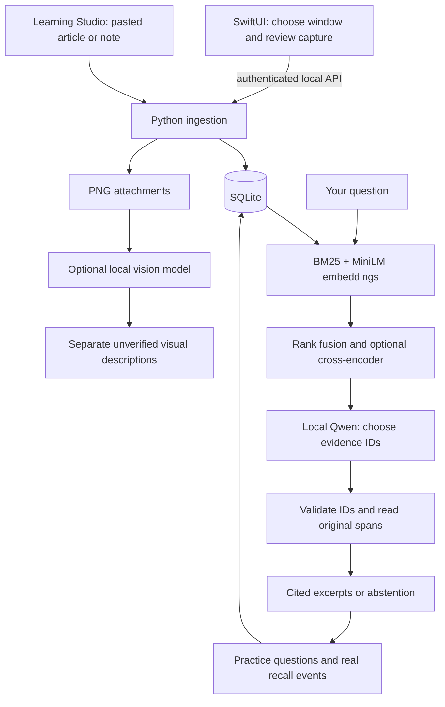

# Architecture — Python engine, native capture

## Component boundaries

**Swift:** SwiftUI, ScreenCaptureKit and Apple Vision implement window selection, permission-aware capture, OCR bounding boxes/confidence and preview. The Swift client does not own retrieval, persistence or generation. `MemoryCore` holds the transfer model and legacy decoding checks. A missing selection is not replaced with an arbitrary first window. Capture refreshes the window reference and checks exclusions; content can still change during a capture.

**Browser import:** an optional Manifest V3 extension uses user-triggered `activeTab`/`scripting`, extracts selected/article/main DOM text and exports JSON. It has no host permissions, backend token, background collection or network calls. Studio imports an export into a review form without auto-saving. Plain HTML imports prefer semantic article/main content and retain the raw input. Browser extraction provenance and figure captions are stored separately from OCR coordinates.

**Python:** FastAPI on 127.0.0.1:8765 owns storage and intelligence. The native launcher starts the repository virtual environment when required. Learning Studio is static HTML/CSS/JavaScript served by the same process. It uses text-only DOM insertion for memory content, a local bearer token, no wildcard CORS, and a restrictive content security policy. This is a source-checkout application, not yet a standalone installer.

**Models:** sentence-transformers MiniLM supplies 384-dimensional embeddings. A MiniLM cross-encoder scores query/passage pairs. Both use pinned revisions and local-only runtime loading. Ollama serves Qwen 2.5 7B for selection/planning and optional Qwen 2.5 VL 3B for images. Generation is serialized and models unload after a response; this trades latency for memory headroom. Ollama tags are recorded in reports, but may change on a future pull; retain model digests when publishing further benchmarks.

## SQLite schema

| Table | Contents and relationship |
| --- | --- |
| `memories` | Stable UUID, original/cleaned text, source/title, extraction metadata, capture and optional publication time, kind, image hash, OCR regions, topic, screening flag |
| `chunks` | Source sentence spans and offsets, linked to a memory |
| `chunks_fts` | FTS5 mirror of chunks, kept in sync for future indexed lookup |
| `embeddings` | Chunk vector plus model revision; vectors are stored as binary values |
| `reviews` | User-approved question, exact source answer, interval and due time |
| `events` | Recall outcome, hint use, elapsed days and prior-history features, typed recall and correction text |
| `vision` | Unverified labels/relationships, model and uncertainty, linked to a memory |
| `traces` | Bounded agent actions/results and proposed drafts |
| `meta` | Migration marker and internal metadata |

Schema version 2 adds extraction provenance and optional typed-answer/correction columns to version 1 without replacing existing rows. It uses `PRAGMA user_version`, foreign keys and cascading deletion. WAL is not enabled; secure deletion is requested. A process lock protects the shared SQLite connection. Identical images share a hash-named attachment. A memory deletion removes unreferenced images and clears traces. The legacy JSON is deliberately retained after an idempotent migration; deletion is not a guarantee of erasure from backups or SSD storage.

**Search implementation detail:** current BM25 scoring scans candidates in Python; the FTS5 mirror is maintained but is not yet used to accelerate query ranking. Dense vectors are also scanned in process. This keeps a small local library simple; larger collections need measured indexing changes, not a claim of unlimited scale.

## Question path and hallucination controls

1. Select all memories or an explicit memory scope. Exclude sources matching conservative instruction-override patterns.
2. Retrieve lexical and/or semantic candidates. Fuse rankings with reciprocal-rank fusion; optionally rerank the best candidates.
3. Present at most eight source spans as E1, E2, etc. Ask the model for schema-constrained selected IDs and a conflict flag. An empty selection means missing support; a redundant support boolean was removed after false-refusal testing.
4. Reject unknown IDs. Return original stored text, source metadata and timestamps. Offer clarification choices for general topic requests and missing referents. Before evidence selection, a conservative attribute guard excludes passages that do not even state the requested color, connection or shape; label order alone is not structure. These admission rules do not prove relevance.
5. If requested, generate a separately labelled interpretation with citation IDs. IDs are validated and a second local-model call checks claims against their cited excerpts. Unaccepted claims are withheld. Both calls use the same fallible model: semantic entailment and factual truth are **not proven**.
6. Discard the answer if memories change during generation, preventing stale cited answers after deletion.

These controls prevent fabricated quote text in the default response, but cannot guarantee selection relevance, source truth, conflict detection or recall. Pattern screening can miss attacks or block legitimate security articles. The user can inspect original OCR and images. Source content has no authority to grant tools or permissions.

## Learning and agency

The immediate review schedule is a rule: independent success doubles an interval up to 90 days; failure or hints resets it to one day. Reading/capture does not produce a mastery event. Self-reported outcomes may be noisy.

After at least 50 real events with successes and failures, logistic regression estimates recall using elapsed days, earlier attempts and earlier accuracy. A chronological 80/20 split reports Brier score and log loss against a mean-probability baseline; final inference then fits all observed history. The sample gate is a minimum, not evidence of sufficient data or model superiority. The schedule remains rule-based. A shadow interval comparison is available only with at least 20 chronological held-out outcomes of both classes, better Brier score than the mean baseline, and a negative elapsed-time coefficient. It targets 80% estimated recall across bounded candidate intervals; it never changes the actual due date. Synthetic comparisons test this mechanism, not human learning efficacy. Real longitudinal data is still needed.

The agent makes at most five model-selected actions from `search_memory`, `read_source`, `get_due_topics`, `draft_quiz`, and `finish`. Source access is constrained to returned memories, draft answers must come from known evidence, and saving is explicit. No shell, arbitrary network, email or general filesystem tools exist in this action vocabulary. Traces support inspection, not a promise that every plan is good.

## Training and evaluation

The versioned corpus contains 36 original synthetic documents across six topics. Concept groups separate 18 training, 6 development and 12 test documents. Retrieval is measured on 24 answerable test queries against the corpus; missing-answer behaviour is tested separately.

Experiments compare TF-IDF logistic regression, logistic regression over frozen transformer embeddings, and a trained PyTorch 384→64→6 head with dropout and AdamW. Development loss controls early stopping; test data does not choose hyperparameters. The transformer and Qwen weights are pretrained, not trained by this project. Personal fine-tuning needs an appropriately consented dataset and a baseline comparison before it is justified.
