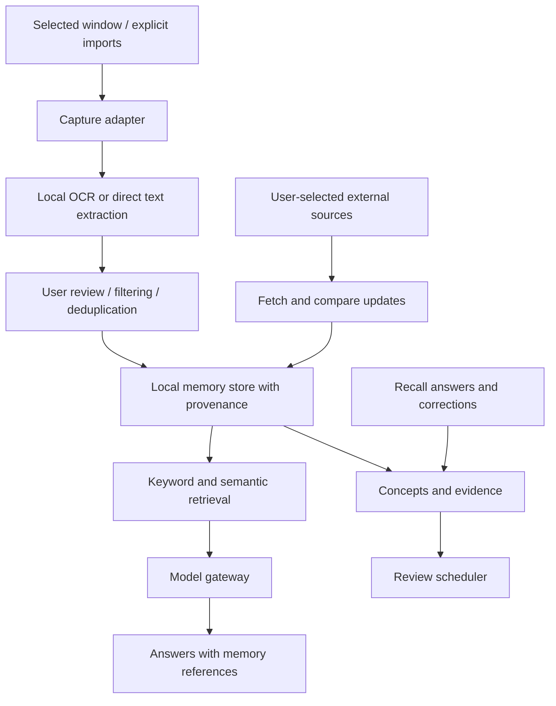

# Architecture and setup

The CV-oriented research scope, model-training experiments, agent design, and evaluation protocol are defined in [PORTFOLIO_PLAN.md](PORTFOLIO_PLAN.md). The Python research track is now started with an offline BM25 baseline; it is not yet connected to the native app.

## Product boundary

One memory across coding, college, articles, and personal interests. Separate exposure (seen), evidence (answered/applied), and tentative understanding (estimated). Passive screen activity is not proof of weakness or mastery. Casual reading should not automatically become revision homework.

## System design

Implemented now: selected-window capture, local OCR, user review, manual notes, local JSON persistence, keyword retrieval, deletion, native app/menu bar. The rest is planned.

## Layers and technology choices

1. **Native client:** SwiftUI for windows, status, capture scope, timeline, and chat. ScreenCaptureKit for window capture; Vision for OCR. Start on demand, later add explicit start/stop sessions with an allowlist and visible indicator.
2. **Memory engine:** Swift library in the initial app, avoiding a background server and extra installation. Move the JSON store to SQLite with transactions and full-text search before automatic sessions. Add embeddings only after keyword search has been measured. A Python worker remains optional for model experiments; it is not needed for the first milestone.
3. **Ingestion:** Prefer actual text from explicit file imports or a future browser extension over screenshots where available. Track source URL only when supplied by the source or user, never invent it from a title. Preserve document versions and extraction confidence. Deduplicate identical content and group related changes.
4. **Retrieval:** Combine keyword and semantic candidates; filter by date/source/topic; return original passages and stable IDs. Distinguish quotes, retrieved observations, and generated conclusions. No-match results should say there is insufficient memory.
5. **Model gateway:** One interface for summarization, grounded answers, concept extraction, and question generation. Choose a cloud provider or local model after checking hardware, privacy preference, latency, and budget. Explicitly disclose which passages leave the device. Store secrets in Keychain; never source control or chat.
6. **Learning model:** Concepts link to observations and evidence such as independent answers, hints, corrections, and applications. Store uncertainty and let the user correct assessments. Estimate by topic, not global labels such as “bad at math.”
7. **Review:** Schedule user-prioritized concepts using recall performance and desired exam dates. News and casual reading are searchable by default, not automatically quizzed.
8. **Updates:** Opt-in RSS/source monitoring with publication and retrieval timestamps, attribution, version comparisons, and a notification budget. “Current” always means checked against named sources at a recorded time.

## Target entities

- `sources`: type, URL/path, title, application, retrieved_at, published_at.
- `observations`: source_id, session_id, text, hash, captured_at, extraction_method.
- `chunks`: observation_id, text, offsets, optional embedding/version.
- `concepts`: name, description, user priority.
- `concept_links`: concept_id, observation_id, relation, confidence.
- `evidence`: concept_id, prompt, answer, hints, assessment, timestamp.
- `reviews`: concept_id, due_at, previous outcomes.
- `claims`: source_id, claim text, publication date, conflicting/superseding claim links.
- `preferences`: capture allowlist, retention, cloud consent, review settings.

Deletion must cascade into chunks, embeddings, derived summaries, and learning evidence, or mark dependent assessments invalid. External backup retention must be described separately.

## Setup and access

| Item | Needed when | Access |
| --- | --- | --- |
| Swift command-line tools | Now; detected on this Mac | Compile locally in this project |
| macOS 14+ | Now; host meets minimum | Native frameworks |
| Screen Recording permission for Second Brain | Interactive capture test | Selected window capture; user grants via macOS |
| Full Xcode | Optional now, useful for debugging/signing | No Apple account needed for current local package build |
| GitHub | Optional backup and collaboration | A dedicated repository; no account-wide write access needed for prototype |
| Cloud AI provider | AI milestone, if chosen | API key entered locally and stored in Keychain; metered usage |
| Local model runtime | AI milestone, alternative to cloud | Model download and sufficient RAM/disk, hardware-dependent |
| Browser extension | Later, optional | Explicit site permissions for better page text/URLs |
| Drive/Notion integrations | Later, only if requested | User-selected documents and provider OAuth |

No Full Disk Access, Accessibility, microphone, camera, mail, calendar, or contacts access is required for the current design. Codex plugins help development or access connected services inside Codex; they are not automatically integrations or credentials for the standalone Mac app. The app needs its own future provider integrations.

## Build sequence and acceptance criteria

1. **Capture and memory (current):** save/reopen/search/delete notes; inspect OCR from an authorized selected window; verify permission denial produces a useful error.
2. **Grounded assistant:** migrate storage; add provider boundary and source-backed answers. Evaluate using known questions plus unanswerable questions, and adversarial text captured from webpages.
3. **Learning evidence:** add concept edits, quiz answers, confidence, and review scheduling. Check that viewing time alone never changes mastery.
4. **Automatic sessions:** add start/stop, allowlists, change detection, retention, and resource limits. Test exclusions before capture/transmission, immediate stop, and duplicate control.
5. **Updates:** add selected sources and change summaries with citations; test old/new dates and conflicting claims.

Captured content is untrusted data. It cannot authorize tool actions, override instructions, or request credentials. Tool actions, if added later, need an independent permission boundary.

## Apple references

- https://developer.apple.com/documentation/screencapturekit
- https://developer.apple.com/documentation/screencapturekit/scscreenshotmanager
- https://developer.apple.com/documentation/vision/recognizing-text-in-images

## Implemented local AI extension

Budget decision: ₹0 API spending. Host verified as Apple M2 with 16 GB RAM. Reuse installed Ollama and qwen2.5:7b-instruct. Selected-memory questions now call a fixed loopback endpoint, reject redirects, limit excerpt/context/output size, and cite the selected memory as [1]. This is single-memory assistance, not the planned cross-memory retrieval pipeline. No cloud model integration is enabled.
