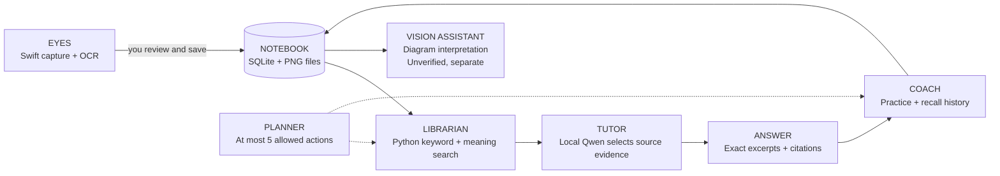

# Remember it as a small study team

**Eyes → Notebook → Librarian → Tutor → Coach. A Planner coordinates a short session.**

| Remember | Actual technology | What it does |
| --- | --- | --- |
| Eyes | SwiftUI, ScreenCaptureKit, Apple Vision | Sees a selected visible window; preserves screenshot, OCR text and positions |
| Notebook | SQLite + local PNG attachments | Remembers sources, text, embeddings, images, quizzes and outcomes |
| Librarian | Python, BM25, MiniLM transformer, rank fusion, cross-encoder | Finds useful passages even when the question uses different wording |
| Tutor | Ollama + Qwen 2.5, schema validation | Selects evidence IDs; the program displays original excerpts or refuses |
| Coach | Spaced-review rules + experimental scikit-learn recall model | Schedules practice and uses real attempts, not reading time |
| Planner | Bounded model-driven tool loop | Searches and drafts a study session; you decide what to save |
| Vision assistant | Qwen 2.5 VL | Suggests labels and relationships without turning them into verified facts |

Example: you read “a base case stops recursion,” save it, then ask “how does recursion terminate?” The librarian retrieves the passage by words and meaning. Qwen selects its evidence ID. Python checks the ID and returns the original sentence with a source. You can create a practice card and later record whether you recalled it without a hint.

**Where the AI concepts are:** ML = trained topic and recall classifiers; DL = trained PyTorch topic head; transformers = MiniLM encoder/cross-encoder; LLM = local Qwen; generative AI = optional explanation/quiz wording; agentic AI = model-selected bounded tools. The project trains small classifiers, not an entire foundation model.

**What “learns with me” means today:** the memory collection grows, search uses it, and genuine practice history can train a small recall predictor. Qwen's weights do not change when you read a page. Saved material is not automatically up to date; importing a newer version preserves a newer source.
