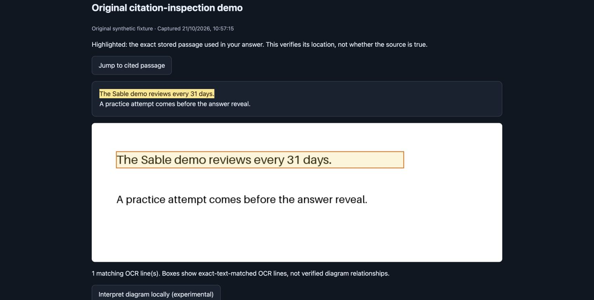

# Milestone 0.4 — completed 22 October 2026

The implementation adds FTS5 keyword candidates, background embedding ingestion, cached exact dense retrieval, passage/OCR-region inspection, and a failure-visible Evidence lab. Measurements and browser checks were performed on 21 October; final documentation and publication were completed on 22 October. Tests use original disposable fixtures and do not add attempts or memories to the personal library.

## Quality: preserve the failures

The dataset was committed before implementation in `8cf97e7`, with separate development and test source pools. It is agent-authored, **not independently human-reviewed**. No answer prompts or guards were changed to fit these results.

| Test metric | Result |
| --- | ---: |
| Strict cases passed | 19/24 |
| Runtime errors | 0 |
| Answerable cases | 17 |
| False refusals | 0/17 |
| Missing-evidence cases answered with citations | 1/6 |
| Gold-matched citations | 18/22 (81.8%) |
| Answer p50 / p95 | 5.05 / 7.16 s |

All four retrieval modes found all annotated passages within the top five on this small set, for both historical and current implementations. Current MRR@5 was .971 keyword, .931 dense, .912 hybrid and 1.000 reranked. The development set scored 4/6 strict passes. These are fixture-specific scores, not general accuracy estimates.

The five strict test failures:

- **test-10:** cited seedling growth as support for root length, despite the source saying root length was not measured. This is a substantive unsupported selection.
- **test-11:** returned both old and new bulletin dates for a question restricted to the new bulletin, and flagged conflict.
- **test-12:** returned both correct dated excerpts but did not set the expected conflict flag. Whether historical revision should be a contradiction deserves independent label review; the original label and score are unchanged.
- **test-16:** returned both failure and success branches when asked only about failure, and flagged conflict.
- **test-19:** returned both seminar and tutorial rooms for a tutorial question, and flagged conflict.

The last three extra-context/flag patterns are not invented quotations. Exact quotation validation still does not guarantee relevant selection. The dashboard shows every failed question with gold and returned evidence. Generated explanation support checks were not evaluated in this run.

## Retrieval responsiveness

Measured on this Mac, using real pinned MiniLM query encoding, 20 warm queries per mode/engine, and no concurrent LLM workload:

| Memories | Mode | Historical p95 | Current p95 |
| ---: | --- | ---: | ---: |
| 1,000 | Keyword | 12.0 ms | 2.1 ms |
| 1,000 | Dense | 30.1 ms | 11.8 ms |
| 1,000 | Hybrid | 28.5 ms | 10.9 ms |
| 5,000 | Keyword | 71.8 ms | 11.0 ms |
| 5,000 | Dense | 127.1 ms | 28.6 ms |
| 5,000 | Hybrid | 131.0 ms | 33.1 ms |

These are retrieval times, not complete answer latency. The historical implementation comes from `18e9e59`. Both engines use the same stored vectors and encoder. FTS5 ranking differs from the original Python BM25 statistics. Dense scoring remains linear; there is no ANN index. Cold application startup, image ingestion and large concurrent workloads are not measured. Peak process memory and indexing times are included in the raw report.

## Inspection and reliability checks

- 42 Python tests passed, including frozen-dataset validation, scorer checks, citation ownership/Unicode/repeated spans, invalid OCR coordinates, scoped FTS lookup, deletion races, worker retry and cached-vector invalidation.
- Native release build and memory transfer/legacy compatibility passed.
- Five historical research metric tests passed. Browser script syntax passed.
- In an isolated Chrome demo, a real local answer cited the 31-day sentence. **Inspect cited passage** highlighted the exact stored text and the matching screenshot line. No new screenshot was captured from the user's private desktop.
- Evidence lab displayed the completed 19/24 result, retrieval comparisons and five failed cases; expanding test-10 showed its incorrect root-length evidence.
- The restarted app connected to engine 0.4.0 and displayed its three existing memories. The disposable service on port 8767 was no longer listening at cleanup.
- The app remains ad-hoc signed by user choice. Rebuilding can require renewed macOS capture permission; screen capture was not reverified in this milestone.

## Reproduce and inspect

- [Frozen dataset](../backend/data/milestone-v3/benchmark.json) and [manifest](../backend/data/milestone-v3/manifest.json)
- [Raw quality and retrieval rankings](milestone-v3-results.json)
- [Raw performance measurements](retrieval-performance-v3.json)
- [Protocol and independent-review boundary](../docs/evaluation-protocol.md)
- [Decision history](../decisions.md)

Run the commands in README with fresh output paths; existing reports are never overwritten by the milestone scripts. Use Open Learning Studio → Evidence lab to inspect the published results, or run the disposable demo. Citation inspection is available in Learning Studio; native capture remains Swift-owned.
